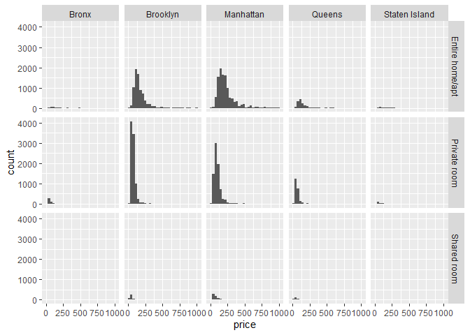
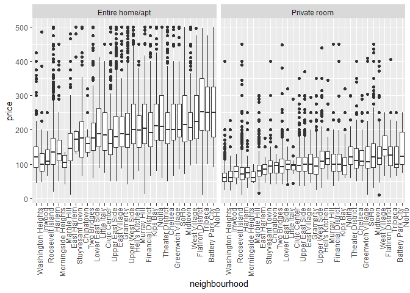
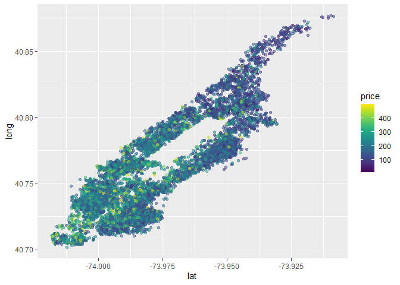

case_study
================

``` r
library(tidyverse)
```

    ## ── Attaching core tidyverse packages ──────────────────────── tidyverse 2.0.0 ──
    ## ✔ dplyr     1.2.1     ✔ readr     2.2.0
    ## ✔ forcats   1.0.1     ✔ stringr   1.6.0
    ## ✔ ggplot2   4.0.3     ✔ tibble    3.3.1
    ## ✔ lubridate 1.9.5     ✔ tidyr     1.3.2
    ## ✔ purrr     1.2.2     
    ## ── Conflicts ────────────────────────────────────────── tidyverse_conflicts() ──
    ## ✖ dplyr::filter() masks stats::filter()
    ## ✖ dplyr::lag()    masks stats::lag()
    ## ℹ Use the conflicted package (<http://conflicted.r-lib.org/>) to force all conflicts to become errors

``` r
library(p8105.datasets)

data("nyc_airbnb")
```

## some questions

most expensive / cheapest highest concentration most / best review
number increased / descreased over time

``` r
nyc_airbnb |>
  count(room_type, neighbourhood_group) |>
  pivot_wider(
    names_from = room_type,
    values_from = n
  )
```

    ## # A tibble: 5 × 4
    ##   neighbourhood_group `Entire home/apt` `Private room` `Shared room`
    ##   <chr>                           <int>          <int>         <int>
    ## 1 Bronx                             192            429            28
    ## 2 Brooklyn                         7427           9000           383
    ## 3 Manhattan                       10814           7812           586
    ## 4 Queens                           1388           2241           192
    ## 5 Staten Island                     116            144             1

``` r
nyc_airbnb |>
  filter(neighbourhood_group == "Manhattan") |>
  count(room_type, neighbourhood) |>
  pivot_wider(
    names_from = room_type,
    values_from = n
  )
```

    ## # A tibble: 32 × 4
    ##    neighbourhood      `Entire home/apt` `Private room` `Shared room`
    ##    <chr>                          <int>          <int>         <int>
    ##  1 Battery Park City                 44             19             2
    ##  2 Chelsea                          774            274            24
    ##  3 Chinatown                        195            164             1
    ##  4 Civic Center                      25             17            NA
    ##  5 East Harlem                      433            558            57
    ##  6 East Village                    1093            742            23
    ##  7 Financial District               229            145            17
    ##  8 Flatiron District                 77             12             1
    ##  9 Gramercy                         185            116             6
    ## 10 Greenwich Village                287             93             3
    ## # ℹ 22 more rows

\##price

``` r
nyc_airbnb |>
  mutate(price_rank = min_rank(price)) |>
  filter(price_rank < 3)
```

    ## # A tibble: 6 × 18
    ##         id review_scores_location name     host_id host_name neighbourhood_group
    ##      <dbl>                  <dbl> <chr>      <dbl> <chr>     <chr>              
    ## 1 15756355                     NA Large S…  1.06e7 Bryan     Brooklyn           
    ## 2 16699731                      9 Quaint …  1.03e7 Gregory   Manhattan          
    ## 3 18252313                     NA Modern …  2.33e6 Bunmi     Manhattan          
    ## 4 17979764                     NA Jen Apt   8.45e7 Jennifer  Manhattan          
    ## 5 12885815                     10 Turtle …  7.05e7 Leonardo  Manhattan          
    ## 6 10282229                     NA hrly to…  5.29e7 Jay       Manhattan          
    ## # ℹ 12 more variables: neighbourhood <chr>, lat <dbl>, long <dbl>,
    ## #   room_type <chr>, price <dbl>, minimum_nights <dbl>,
    ## #   number_of_reviews <dbl>, last_review <date>, reviews_per_month <dbl>,
    ## #   calculated_host_listings_count <dbl>, availability_365 <dbl>,
    ## #   price_rank <int>

``` r
nyc_airbnb |>
  group_by(neighbourhood_group) |>
  mutate(price_rank = min_rank(desc(price))) |>
  filter(price_rank < 10)
```

    ## # A tibble: 45 × 18
    ## # Groups:   neighbourhood_group [5]
    ##          id review_scores_location name    host_id host_name neighbourhood_group
    ##       <dbl>                  <dbl> <chr>     <dbl> <chr>     <chr>              
    ##  1  6074499                     NA Ocean …  1.72e6 Marc      Staten Island      
    ##  2   738588                      8 Weddin…  1.36e6 Marina    Staten Island      
    ##  3 13138261                      7 Huge 9…  7.32e7 Siqueira  Queens             
    ##  4  1229566                      9 Cozy C…  4.07e6 Johnny Q… Brooklyn           
    ##  5 14800877                     NA Heart …  2.91e7 Sammy     Brooklyn           
    ##  6 18175061                     NA Magnif…  1.25e8 Sean      Queens             
    ##  7 12156541                     NA One la…  6.53e7 Bobnkay   Queens             
    ##  8  3103784                     10 A Priv…  9.83e6 Michael   Brooklyn           
    ##  9  2271504                     NA SUPER …  1.16e7 Jonathan  Brooklyn           
    ## 10  2952861                     10 Photog…  1.18e6 Jessica … Brooklyn           
    ## # ℹ 35 more rows
    ## # ℹ 12 more variables: neighbourhood <chr>, lat <dbl>, long <dbl>,
    ## #   room_type <chr>, price <dbl>, minimum_nights <dbl>,
    ## #   number_of_reviews <dbl>, last_review <date>, reviews_per_month <dbl>,
    ## #   calculated_host_listings_count <dbl>, availability_365 <dbl>,
    ## #   price_rank <int>

``` r
nyc_airbnb |>
  filter(price < 1000) |>
  ggplot(aes(x = price)) +
  geom_histogram() +
  facet_grid(room_type ~ neighbourhood_group)
```

    ## `stat_bin()` using `bins = 30`. Pick better value `binwidth`.

<!-- -->

price average

``` r
nyc_airbnb |>
  group_by(room_type, neighbourhood_group) |>
  summarize(
    mean_price = mean(price)
  ) |>
  pivot_wider(
    names_from = room_type,
    values_from = mean_price
  )
```

    ## `summarise()` has regrouped the output.
    ## ℹ Summaries were computed grouped by room_type and neighbourhood_group.
    ## ℹ Output is grouped by room_type.
    ## ℹ Use `summarise(.groups = "drop_last")` to silence this message.
    ## ℹ Use `summarise(.by = c(room_type, neighbourhood_group))` for per-operation
    ##   grouping (`?dplyr::dplyr_by`) instead.

    ## # A tibble: 5 × 4
    ##   neighbourhood_group `Entire home/apt` `Private room` `Shared room`
    ##   <chr>                           <dbl>          <dbl>         <dbl>
    ## 1 Bronx                            125.           65.5          57.5
    ## 2 Brooklyn                         175.           76.7          59.6
    ## 3 Manhattan                        238.          107.           84.7
    ## 4 Queens                           140.           70.6          49.1
    ## 5 Staten Island                    207.           65.4          25

``` r
nyc_airbnb |>
  filter(neighbourhood_group == "Manhattan") |>
  filter(price < 500) |>
  filter(room_type != "Shared room") |>
  mutate(neighbourhood = fct_reorder(neighbourhood, price)) |>
  ggplot(aes(x = neighbourhood, y = price)) + 
  geom_boxplot() +
  facet_grid(. ~ room_type) +
  theme(axis.text.x = element_text(angle = 90, hjust = 1))
```

<!-- -->

\##visualize price some more map

``` r
nyc_airbnb |>
  filter(neighbourhood_group == "Manhattan") |>
  filter(room_type == "Entire home/apt") |>
  filter(price < 500) |>
  ggplot(aes(x = lat, y = long, col = price)) +
  geom_point(alpha = 0.5) + 
  viridis::scale_color_viridis(
    name = "price"
  )
```

<!-- -->
